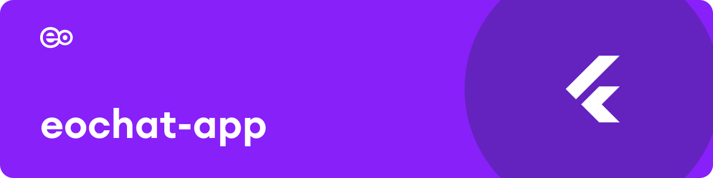

<p align="center">EOchat, the EO's mobile app for its own AI chat.</p>

<p align="center">
  <a href="https://apps.apple.com/us/app/eochat/id6763726069">App Store</a> ·
  <a href="https://play.google.com/store/apps/details?id=nl.eo.eochat">Google Play</a> ·
  <a href="https://chat.eo.nl">chat.eo.nl</a>
</p>

EOchat puts chat.eo.nl, the EO's own Open WebUI server, on iPhone and Android: sign in with your Microsoft work account and the chats, models and tools from the web are on your phone. It is a fork of [Conduit](https://github.com/cogwheel0/conduit), the open-source Open WebUI client, kept close to upstream and released under the same GPL-3.0 licence.

## What it does

- **Straight to chat.eo.nl.** There is no server to set up: the app connects to the EO server and signs in with Microsoft single sign-on.
- **Conduit's chat on your phone.** Streaming chat, voice, notes, files and images, home-screen widgets and the share sheet come from Conduit; [its README](https://github.com/cogwheel0/conduit#readme) describes them.
- **In EO colours.** EOchat branding and the EO palette, with interface polish of its own.
- **Opknapper.** The EO's AI training game as a tab in the app, with reminders.

## Getting started

To use the app, install EOchat from the App Store or Google Play and sign in. To build it, clone with `--recursive`, because the Mermaid renderer is a submodule, then:

```bash
flutter pub get
dart run build_runner build && (cd packages/conduit_core && dart run build_runner build)
flutter run
```

This needs the Flutter SDK, plus Xcode for iOS or the Android SDK for Android.

## Contributing

Working on this repo? [AGENTS.md](./AGENTS.md) has the setup, conventions and checks.
